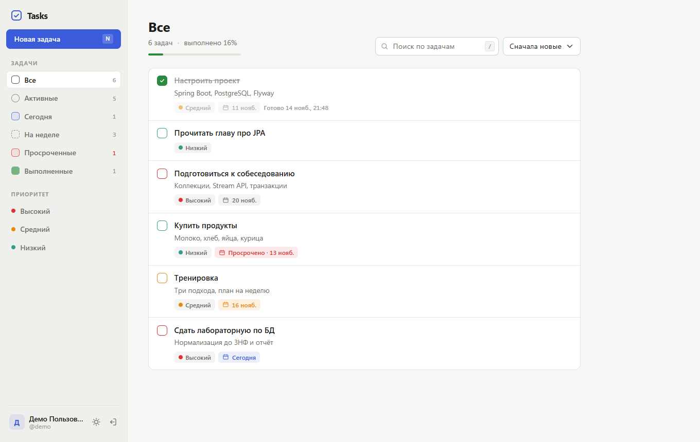
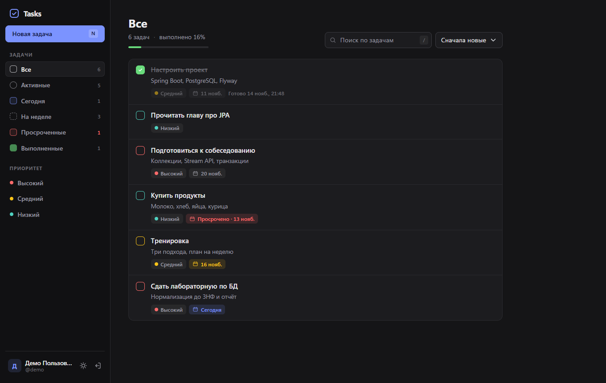
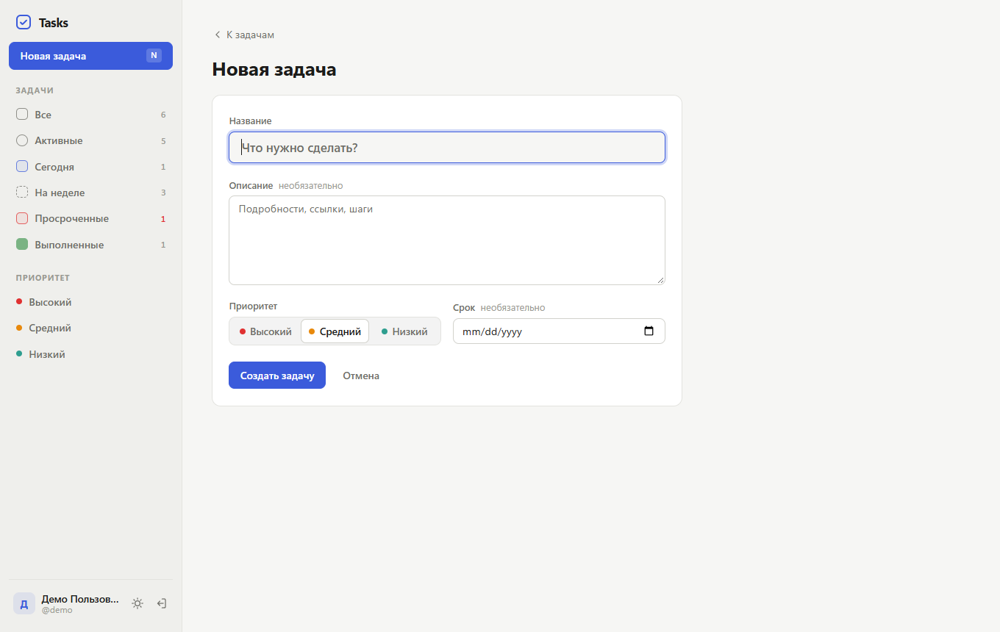
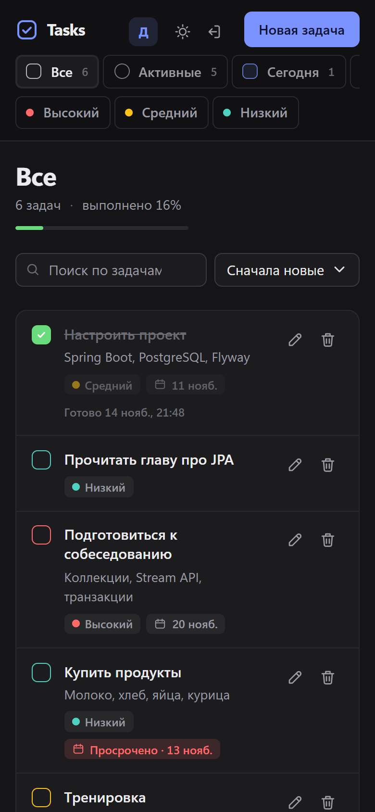

# Tasks Manager

Веб-приложение для личных задач: приоритеты, сроки, поиск, фильтры и REST API. Каждый пользователь видит только свои задачи.



| Тёмная тема | Новая задача | Телефон |
|---|---|---|
|  |  |  |

## Что умеет

- Регистрация и вход по логину и паролю, «запомнить меня» на 30 дней.
- Задачи с названием, описанием, приоритетом (высокий, средний, низкий) и сроком.
- Списки: все, активные, на сегодня, на неделю, просроченные, выполненные. Счётчики в боковой панели.
- Фильтр по приоритету, поиск по названию и описанию, сортировка по дате, сроку, приоритету и названию.
- Профиль со статистикой и редактированием имени.
- Светлая и тёмная тема, вёрстка под телефон, горячие клавиши: `N` — новая задача, `/` — поиск.
- REST API с тем же набором операций.

## Стек

Java 21, Spring Boot 3.5, Spring MVC, Spring Security, Spring Data JPA, PostgreSQL 17, Flyway, Thymeleaf, Bootstrap 5.3, Lombok, Maven. Тесты: JUnit 5, AssertJ, MockMvc, Testcontainers.

## Запуск

Нужны JDK 21+ и Docker. Maven ставить не нужно, в проекте есть `mvnw`.

```powershell
git clone https://github.com/nmaksimka/tasks-manager.git
cd tasks-manager
docker compose up -d
.\mvnw.cmd spring-boot:run "-Dspring-boot.run.profiles=dev"
```

Откройте http://localhost:8081 и войдите как `demo` / `demo12345`. Профиль `dev` создаёт этого пользователя с примерами задач и задаёт ключ remember-me для локальной разработки.

На Linux и macOS вместо `.\mvnw.cmd` используйте `./mvnw`.

### Переменные окружения

| Переменная | По умолчанию | Назначение |
|---|---|---|
| `DB_URL` | `jdbc:postgresql://localhost:5432/taskdb` | адрес базы |
| `DB_USERNAME` | `postgres` | пользователь базы |
| `DB_PASSWORD` | `postgres` | пароль базы |
| `SERVER_PORT` | `8081` | порт приложения |
| `REMEMBER_ME_KEY` | нет, обязателен вне `dev` | ключ подписи cookie «запомнить меня» |
| `DEMO_PASSWORD` | `demo12345` | пароль демо-пользователя в `dev` |

Без профиля `dev` приложение не стартует, пока не задан `REMEMBER_ME_KEY`. Так секрет не попадёт в репозиторий.

## Тесты

```powershell
.\mvnw.cmd verify
```

- Unit-тесты (`*Test`): статус срока, ссылки фильтров, склонение «задача/задачи/задач».
- Интеграционные (`*IT`): поднимают PostgreSQL в Docker через Testcontainers.
  - **Сервисы**: изоляция задач между пользователями, фильтры по срокам, поиск с `%` и `_`, сортировки, статистика.
  - **Веб и API**: CSRF, валидация, коды 401/404, ProblemDetail, регистрация.

## REST API

Авторизация HTTP Basic, без сессии и без CSRF.

```http
GET    /api/tasks?filter=ACTIVE&priority=HIGH&q=отчёт&sort=DEADLINE
GET    /api/tasks/stats
GET    /api/tasks/{id}
POST   /api/tasks
PUT    /api/tasks/{id}
PATCH  /api/tasks/{id}/complete
PATCH  /api/tasks/{id}/reopen
DELETE /api/tasks/{id}
```

Значения параметров:

- `filter`: `ALL`, `ACTIVE`, `TODAY`, `WEEK`, `OVERDUE`, `COMPLETED`;
- `priority`: `HIGH`, `MEDIUM`, `LOW`;
- `sort`: `NEWEST`, `DEADLINE`, `PRIORITY`, `TITLE`.

```bash
curl -u demo:demo12345 -H "Content-Type: application/json" \
  -d '{"title": "Подготовить отчёт", "priority": "HIGH", "deadline": "2026-12-01"}' \
  http://localhost:8081/api/tasks
```

Ошибки приходят в формате `ProblemDetail`: 400 с полем `errors` при неверных данных, 401 без авторизации, 404 если задачи нет или она чужая.

## Устройство

```
controllers   веб-контроллеры, REST и обработчик ошибок API
services      бизнес-логика, транзакции
repositories  Spring Data JPA и Specification для фильтров
entities      Task, User, Priority
dto           формы, ответы, фильтры и сортировки
security      UserDetails с id пользователя
web           общие данные боковой панели, ссылки фильтров
```

Решения, на которые стоит обратить внимание:

- **Только DTO наружу.** Контроллеры не отдают сущности, поэтому хеш пароля не попадёт в JSON, а ленивые связи не вызовут `LazyInitializationException`.
- **Чужая задача неотличима от несуществующей.** Задачу ищут запросом `findByIdAndUserId`, и в обоих случаях ответ 404. По id нельзя узнать, есть ли такая задача у другого пользователя.
- **Изменения только через POST с CSRF-токеном.** Для REST отдельная цепочка фильтров: Basic-авторизация, без сессии.
- **Фильтры считает база.** Фильтры, поиск и сортировка собираются в `Specification`. В `LIKE` экранируются `%` и `_`.
- **Схемой управляет Flyway.** Hibernate работает в режиме `validate`, `open-in-view` выключен.
- **Время берётся из `Clock`.** Поэтому тесты сроков не зависят от текущей даты.

## Ветки

- `main` — стабильная версия.
- `develop` — разработка, сюда сливаются ветки задач.
